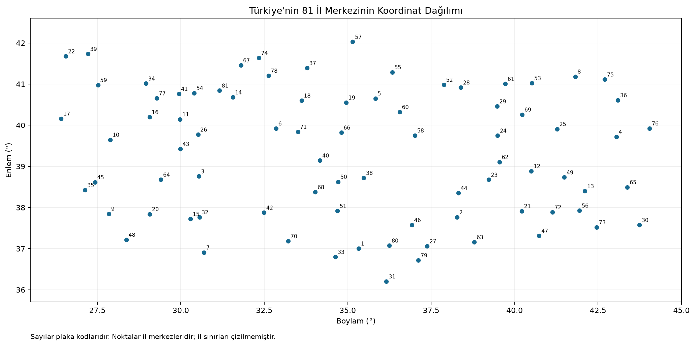
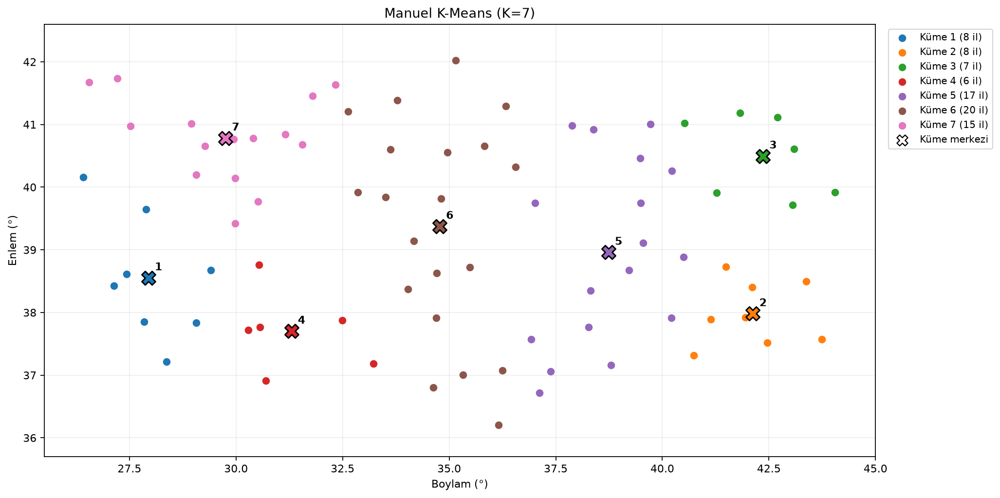
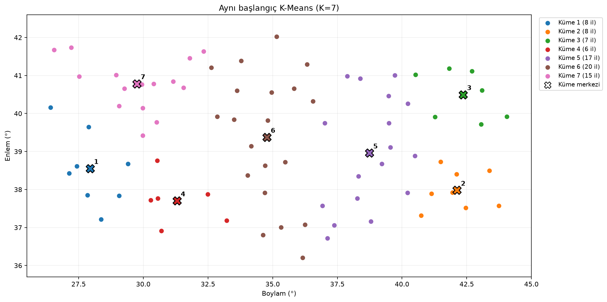
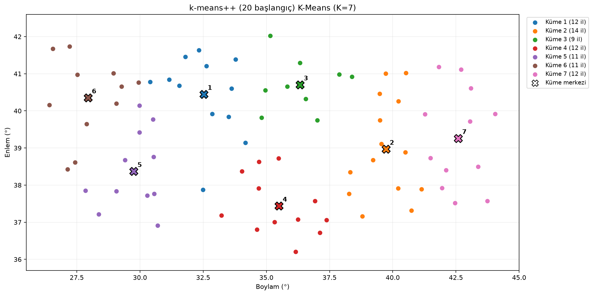
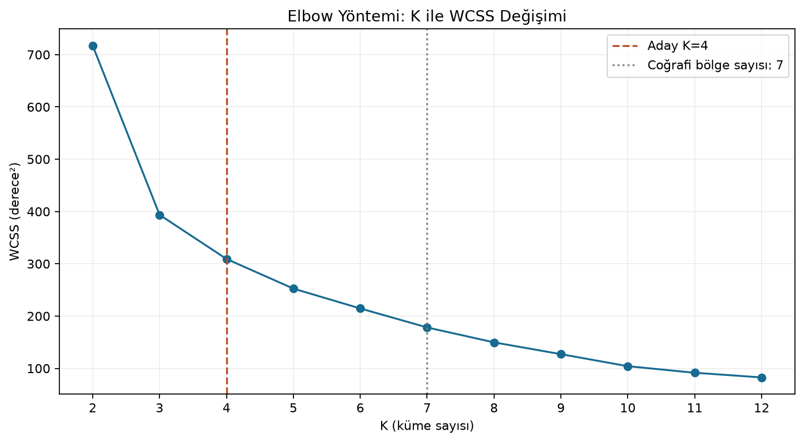
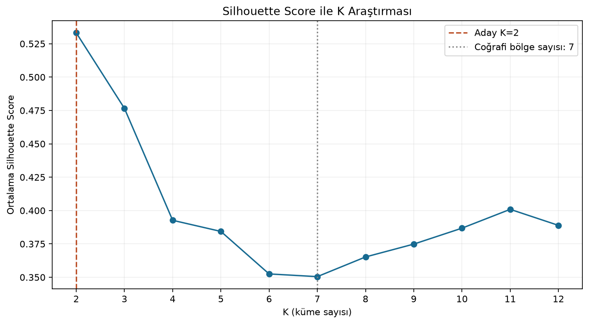
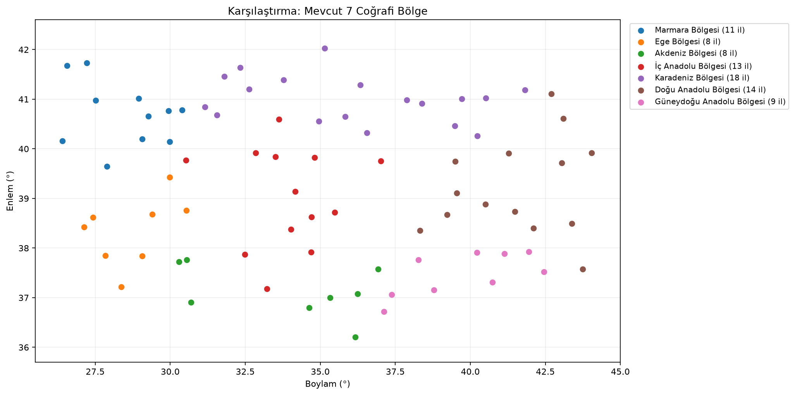
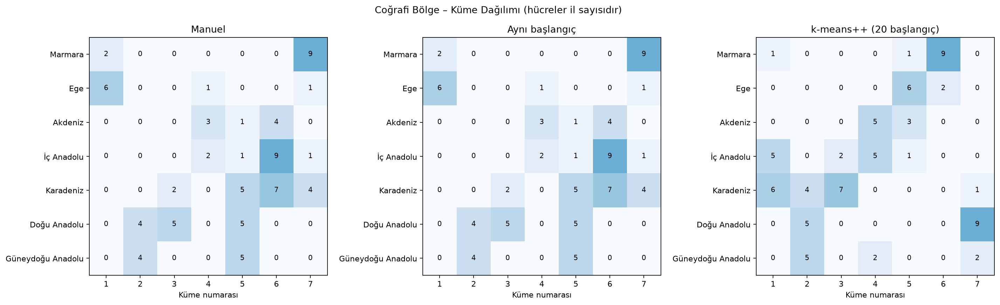

# Türkiye'nin 81 İlinin K-Means ile Kümelenmesi

Makine Öğrenmesi dersi için hazırlanmış sade bir Python projesidir. İl merkezlerinin boylam ve enlem bilgileriyle K-Means uygulanır. Döngülerle yazılan manuel yöntem, scikit-learn ile karşılaştırılır; K=2–12 araştırılır ve sonuçların 7 coğrafi bölgeye benzerliği ölçülür.

## Kurulum ve çalıştırma

Python 3.10 veya üzeri gerekir; deneyler Python 3.12.2 ile çalıştırıldı. Proje klasöründe:

```bash
python -m pip install -r requirements.txt
python main.py
```

Veri dosyası projeye dahildir; normal çalıştırmada internet gerekmez. Program, sonuç CSV'lerini ve grafikleri `sonuclar/` içine yazar. Grafik penceresi açılmaz.

İsteğe bağlı olarak önce `python -m venv .venv` ile sanal ortam oluşturabilirsiniz. Windows PowerShell'de etkinleştirme gerektirmeden `python` yerine `.\.venv\Scripts\python.exe` kullanabilirsiniz. `python` kurulu değilse Python'u kurun; Python Launcher mevcutsa `py` komutu da kullanılabilir. Pyenv kullanılıyorsa kurulu sürümünüzü `pyenv local 3.12.2` gibi bir komutla seçin.

Aşamalar ayrı ayrı da çalıştırılabilir:

```bash
python veri_indir.py          # İsteğe bağlı: veriyi kaynağından tekrar indirir
python kmeans_manuel.py       # Yalnız manuel K=7, CSV, merkezler ve grafik
python kmeans_optimize.py     # İki yöntemi karşılaştırır ve tüm deneyleri üretir
python gorsellestirme.py      # Mevcut CSV sonuçlarından grafikleri yeniden çizer
python -m unittest -v         # Algoritma ve veri kontrol testleri
```

Görselleştirme komutu veri dağılımını ve gerçek bölgeleri her zaman çizer; diğer grafikler için önce `main.py` çalıştırılmalıdır. Dosya yolları programların konumuna göre çözülür, terminalin çalışma klasörüne bağlı değildir.

## Dosyalar ve teknolojiler

```text
data/iller.csv          81 ilin kaynak verisi
veri_indir.py           CSV okuma, doğrulama ve isteğe bağlı indirme
kmeans_manuel.py       Döngülerle K-Means; sklearn kullanmaz
kmeans_optimize.py     Yöntem karşılaştırması, K araştırması ve ARI
gorsellestirme.py      PNG grafikleri
main.py               Bütün deneyleri tek komutla çalıştırır
test_proje.py          Küçük doğruluk ve hatalı veri testleri
veri_setleri.md        Üç öğrenme görevi için veri seti araştırması
requirements.txt      Bağımlılıklar
sonuclar/             Ölçümler, küme üyelikleri, merkezler ve raporlar
  rapor.md            Gerçek ölçümlerden üretilen Markdown deney raporu
  grafikler/          Üretilen PNG dosyaları
```

Manuel algoritma yalnızca Python standart kütüphanesiyle hesaplama yapar. Hazır yöntem için scikit-learn, sayısal veri için NumPy, sonuç dosyaları için pandas, grafikler için Matplotlib kullanılır. `threadpoolctl`, küçük deneyde iş parçacığı sayısını sabit tutar. Arayüz, sunucu veya veritabanı yoktur.

## Veri kaynağı ve kontrolü

Kaynak: [brkunver — Turkish Provinces Dataset](https://github.com/brkunver/turkiye-provinces-dataset). Veri seti CC BY 4.0 lisanslıdır. Bu projede veri yeniden dağıtılmakta, kullanılan bölge adları çıktılarda Türkçeye çevrilmektedir. Kaynak sütunlar CSV'de korunmuştur.

- [Kullanılan sabit CSV sürümü](https://github.com/brkunver/turkiye-provinces-dataset/blob/027db5990f8d220edde133d8e958ed37200ef0c2/data/provinces.csv)
- [Alanların kaynak açıklamaları](https://github.com/brkunver/turkiye-provinces-dataset/blob/027db5990f8d220edde133d8e958ed37200ef0c2/DATA_SOURCES.md)
- [Kaynak veri lisansı](https://github.com/brkunver/turkiye-provinces-dataset/blob/027db5990f8d220edde133d8e958ed37200ef0c2/LICENSE)

Kaynak, koordinatları GeoNames, NGA GIS, Wikidata ve şehir sayfalarından derlenmiş **il merkezi konumları** olarak açıklar. İllerin geometrik merkezleri veya il sınırları kullanılmaz. `region`, kaynağın il başına verdiği yedi coğrafi bölge etiketidir; istatistiksel NUTS sınıfları kullanılmaz.

Her okumada zorunlu sütunlar, boş değerler, sayısal/sonlu koordinatlar, Türkiye için yaklaşık koordinat aralığı, tekrarlanan koordinatlar, 81 farklı il, plaka–il adı eşleşmesi ve yedi geçerli bölgenin bulunması denetlenir. İndirmede doğrulama tamamlanmadan mevcut dosyanın üzerine yazılmaz. Bu kontroller veri bütünlüğünü denetler; her koordinatın bağımsız saha doğrulaması değildir.

Mevcut veride kullanılan alanlarda eksik değer yoktur. Kaynağın bu ödevde kullanılmayan bazı demografik alanları boş olabilir. K-Means girdisi yalnızca `(longitude, latitude)` çiftleridir; il adı, plaka ve bölge algoritmaya özellik olarak verilmez.

## Manuel K-Means nasıl çalışır?

1. `random.Random(42).sample` ile 81 il arasından 7 farklı başlangıç merkezi seçilir.
2. Her noktanın merkezlere kareli Öklid uzaklığı hesaplanır ve en yakın küme seçilir.
3. Küme içindeki koordinatların ortalaması yeni merkez olur.
4. Atamalar veya merkezler değişmeyene kadar işlem yinelenir; üst sınır 300 iterasyondur.
5. Son merkezlere göre üyelikler ve WCSS yeniden hesaplanır.

WCSS, her noktanın atandığı merkeze kareli uzaklıklarının toplamıdır. Aynı veri ve K için düşük olması daha sıkı kümeler anlamına gelir. WCSS, tek başına farklı K değerleri arasında en iyi seçimi belirlemez; K arttıkça genellikle düşer.

Boş küme oluşursa önceki merkez korunur; sıfıra bölünmez. Bu yaklaşım boş kümenin mutlaka dolmasını garanti etmez. Bu veri ve seed ile yedi kümenin tamamı doludur. İterasyon sınırında etiketler son merkezlere göre yenilenir; yakınsama olmadan durulursa merkezler son üyeliklerin ortalaması olmak zorunda değildir.

## Çalıştırılmış deney sonuçları

Aşağıdaki değerler **5 Kasım 2026, 20:44 Türkiye saati** ile yapılan gerçek çalıştırmadan alınmıştır. Ortam: Python 3.12.2, NumPy 2.5.0, pandas 3.0.3 ve scikit-learn 1.9.0. Bütün K ölçümleri, grafikler, küme üyeleri ve merkezler [Markdown deney raporunda](sonuclar/rapor.md) açıklanmıştır. Rapor `python main.py` ile her çalıştırmada yeniden üretilir; README'deki sayılar bu çalıştırmanın kaydıdır. Ham ölçümler [rapor.txt](sonuclar/rapor.txt) ve [yontem_karsilastirma.csv](sonuclar/yontem_karsilastirma.csv) dosyalarındadır.

K=7 için:

- **Manuel:** WCSS **228,276670**, **3 iterasyon**, medyan **1,2072 ms**; gerçek bölgelere karşı ARI **0,243387**.
- **scikit-learn, aynı başlangıç:** WCSS **228,276670**, **3 iterasyon**, medyan **0,9019 ms**; gerçek bölgelere karşı ARI **0,243387**.
- **scikit-learn, k-means++ ve 20 başlangıç:** WCSS **178,261612**, kazanan çözümde **8 iterasyon**, medyan **17,0892 ms**; gerçek bölgelere karşı ARI **0,316252**.

Adil karşılaştırma için ilk iki yönteme aynı sıralı yedi merkez verilir: Burdur, Ağrı, Kars, Isparta, Gümüşhane, Çankırı ve Bolu. İkisi de tek başlangıç, `max_iter=300` ve merkez/atama kararlılığıyla çalışır. Hazır modelde `algorithm="lloyd"`, `tol=0.0`, `n_init=1`, `random_state=42` kullanılır. Yalnız seed değerini eşitlemek, Python ve NumPy'ın aynı merkezleri seçmesini garanti etmez; bu yüzden koordinatlar doğrudan aktarılır.

İki çözümün birbirine karşı ARI değeri **1,0**: küme üyelikleri aynıdır. WCSS farkı yalnızca kayan nokta hassasiyetindedir. Farklı başlangıç merkezleri, birden fazla deneme, tolerans tanımı, boş küme davranışı ve eşit uzaklıkların çözümü farklı sonuçlara yol açabilir. [KMeans parametre açıklamaları](https://scikit-learn.org/stable/modules/generated/sklearn.cluster.KMeans.html), `init`, `n_init` ve durma kriterlerini ayrıntılandırır.

Üçüncü deney başlangıç seçiminin etkisini gösterir: `k-means++` ile 20 çözüm denenip en düşük WCSS seçilir. Kazanç yalnızca kütüphanenin hızına bağlanamaz. Süresi 20 denemenin tümünü, iterasyon sayısı yalnızca kazanan denemeyi kapsar.

Süreler bir ısınma çalıştırmasından sonra **15 tekrarın medyanıdır**; iş parçacığı sınırı 1'dir. Veri okuma, çizim ve değerlendirme metrikleri ölçüm dışındadır; Python tarafındaki girdi kontrolü ve model kurma maliyeti dahildir. Yalnızca 81 nokta olduğundan farklar küçüktür; kütüphane çağrı maliyeti de etkilidir. Bu sayılar genel bir performans üstünlüğü kanıtlamaz ve her çalıştırmada değişebilir.

## K=2–12 araştırması

Her K için `k-means++`, `n_init=20`, `random_state=42`, `max_iter=300`, `tol=0.0` kullanıldı. Bütün ölçümler [k_karsilastirma.csv](sonuclar/k_karsilastirma.csv) dosyasındadır.

- **Silhouette'a göre seçim K=2:** skor **0,533243**. K=3 için **0,476588**, K=7 için **0,350475** bulundu. Bu ölçüte göre daha geniş iki grup daha iyi ayrılıyor.
- **Elbow adayı K=4:** WCSS, K=2'de **717,318300**, K=3'te **393,615104**, K=4'te **309,237118**. İlk büyük düşüşün ardından iyileşme yavaşlıyor. Normalize eğride ilk ve son noktayı birleştiren doğruya en uzak nokta yardımcı bir dirsek önerisi olarak kullanıldı; bu kesin bir optimum kanıtı değildir.
- **K=7**, mevcut bölge sayısıyla karşılaştırma için tutuldu; bu iki ölçütün seçimi olmadı. K=7'de WCSS **178,261612**.

K-Means K değerini kendisi öğrenmez. Bu deneyde ayrışma öncelikliyse K=2; daha ayrıntılı bir gruplayış için Elbow grafiğiyle birlikte K=4 adaydır. Türkiye'nin doğu–batı doğrultusundaki uzanışı ve ham koordinat ölçeği bu seçimi etkiler. Sonuç, Türkiye'nin yalnızca iki veya dört coğrafi bölgesi olduğu anlamına gelmez.

## Yedi coğrafi bölgeyle karşılaştırma

ARI, il çiftlerinin aynı/farklı grupta oluşunu karşılaştırır. Küme 1'in Marmara olduğu gibi bir eşleştirme yapılmaz; küme numaraları yeniden adlandırıldığında ARI değişmez. **1** tam uyum, **0** rastgele etiketlemeye göre beklenen düzeydir; negatif değerler de mümkündür. ARI doğruluk yüzdesi değildir.

Bu deneyde manuel çözümün ARI'si **0,243387**, 20 başlangıçlı çözümünki **0,316252** oldu. İkinci çözüm daha çok örtüşse de gerçek bölgeleri birebir üretmiyor. [Bölge–küme sayıları](sonuclar/bolge_karsilastirma.csv) ve küme CSV'leri ayrıntıları gösterir. Örneğin 20 başlangıçlı sonuçta:

- Marmara'nın 11 ilinden 9'u küme 6'da toplandı; Bilecik küme 5'te, Sakarya küme 1'de kaldı. İzmir ve Manisa da küme 6'ya katıldı.
- Karadeniz'in 18 ili dört kümeye dağıldı. Amasya, Çorum, Giresun, Ordu, Samsun, Sinop ve Tokat küme 3'te bir araya gelirken Artvin küme 7'ye geçti.
- İç Anadolu'nun 13 ili dört kümeye dağıldı; örneğin Ankara küme 1, Kayseri küme 4, Eskişehir küme 5'te yer aldı.

Coğrafi bölge ayrımında iklim, yer şekilleri ve diğer coğrafi özellikler de etkilidir. Coğrafi bölge sınırları il sınırlarıyla tam örtüşmez; burada veri kaynağının il başına tek etiket vermesi bir sadeleştirmedir.

**Yöntem sınırı:** Ham enlem/boylam derecelerine Öklid uzaklığı uygulanır. Standartlaştırma yapılmaz; iki koordinatın derece ölçeği korunur. Dereceler kilometre değildir; WCSS birimi derece²dir. Grafikler nokta dağılımıdır, sınır haritası veya uygun projeksiyona sahip bir coğrafi harita değildir. Gerçek mesafe çalışması için ayrıca uygun bir projeksiyon gerekir.

## Grafikler ve çıktı dosyaları

Sekiz PNG, [sonuclar/grafikler](sonuclar/grafikler/) klasöründedir. Dağılım grafiğindeki sayılar plaka kodlarıdır; il adları CSV'den okunabilir. Küme merkezleri X işaretiyle belirtilir.










Küme üyelikleri `manuel_kumeler.csv`, `optimize_7_kume.csv`, `optimize_iyilestirilmis.csv` dosyalarındadır. Her birinin `_merkezler.csv` dosyası da üretilir. Bütün il listeleri ve merkezler terminalde yazdırılır; açıklamalı sonuçlar `rapor.md`, ölçüm özeti `rapor.txt` içine kaydedilir.

## Doğrulama ve sonuç

11 test; elle çözülebilen örneği, boş kümeyi, tekrarlanabilirliği, iterasyon sınırını, geçersiz parametreleri, scikit-learn ile aynı başlangıçta uyumu ve hatalı/eksik/tekrarlanan verileri kontrol eder. `python -m unittest -v` ile **11 testin tamamı geçti**; ardından `python main.py` ile bütün deneyler, CSV'ler, sekiz PNG ve raporlar yeniden üretildi. Veri indirme komutu da kaynakla doğrulanmıştır.

Manuel uygulama, K-Means'in temel mantığını gösterir. Aynı başlangıçta hazır yöntemle aynı çözüm elde edilir. Daha iyi başlangıç stratejisi WCSS'yi azaltabilir; bu, coğrafi bölgelerle tam uyum anlamına gelmez. Bu veri ve ölçütlerle K=7 zorunlu bir en iyi değer değildir.
