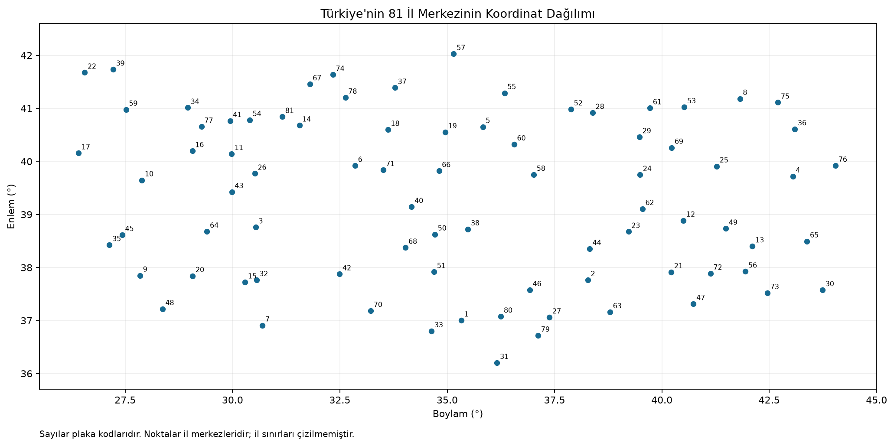
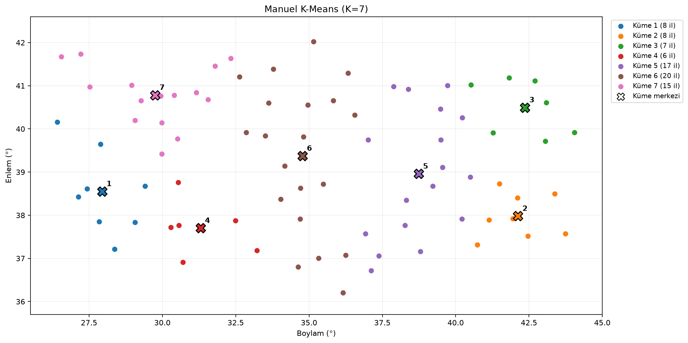
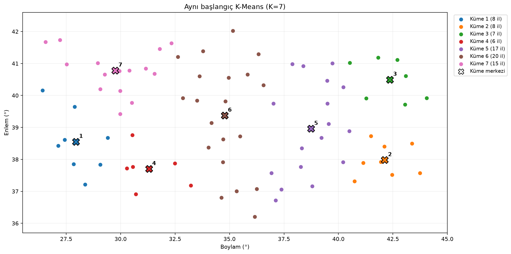
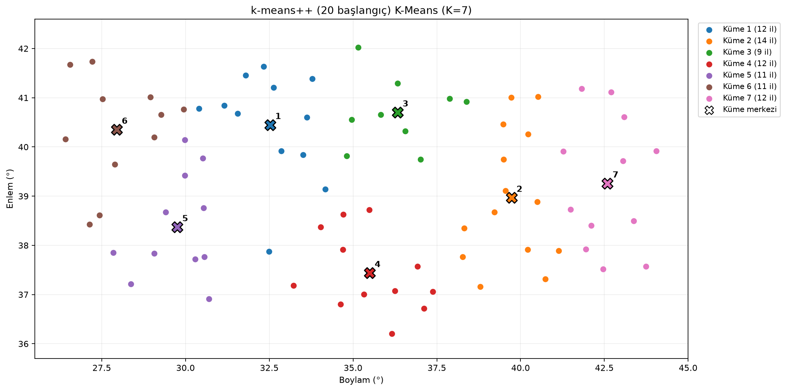
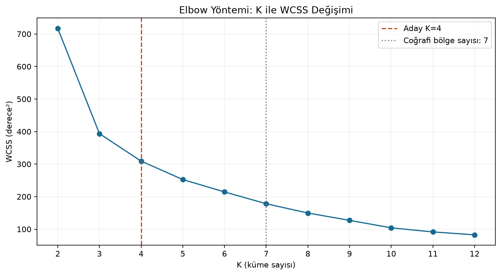
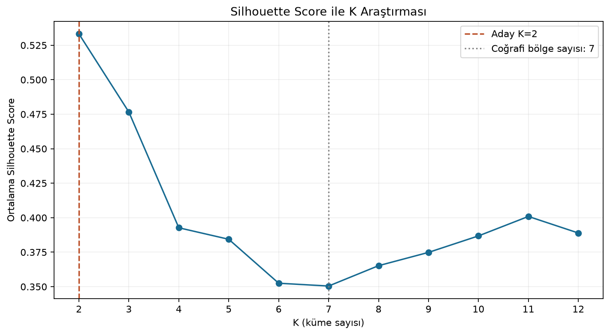
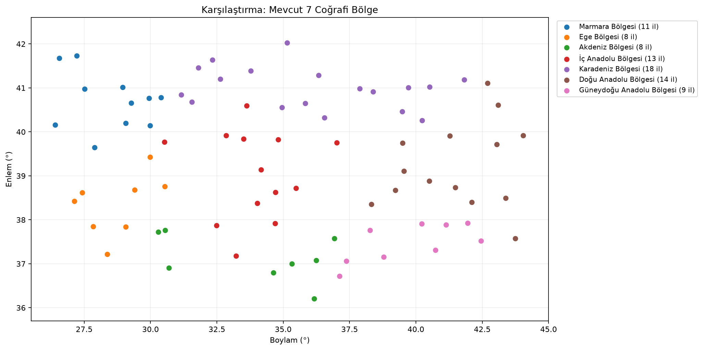
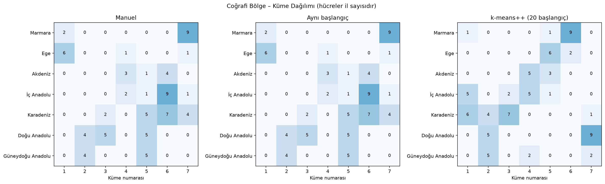

# 81 İl K-Means Deney Sonuçları

Çalıştırma zamanı: **05.11.2026 20:44:50 (Türkiye saati)**.

## Veri ve deney koşulları

81 farklı il ve yedi coğrafi bölge doğrulandı. Kullanılan alanlarda eksik değer yok.
Girdiler il merkezlerinin boylam/enlem çiftleridir; bölge etiketleri eğitime katılmadı.
Python 3.12.2, NumPy 2.5.0, pandas 3.0.3, scikit-learn 1.9.0

`seed=42`, `max_iter=300`, `tol=0`, `algorithm=lloyd`.
İlk iki yönteme aynı yedi il başlangıç merkezi olarak verildi: Burdur, Ağrı, Kars, Isparta, Gümüşhane, Çankırı, Bolu.

Süreler bir ısınma çalıştırmasından sonra 15 tekrarın medyanıdır. İş parçacığı sınırı 1; dosya okuma, çizim ve değerlendirme metrikleri ölçüm dışındadır.

## K=7: yöntemlerin karşılaştırılması

### Manuel

- Başlangıç sayısı: **1**.
- Medyan süre: **1.2072 ms**.
- İterasyon: **3**.
- WCSS: **228.276670** derece².
- Silhouette: **0.300111**.
- Gerçek bölgelere karşı ARI: **0.243387**.

### Aynı başlangıç

- Başlangıç sayısı: **1**.
- Medyan süre: **0.9019 ms**.
- İterasyon: **3**.
- WCSS: **228.276670** derece².
- Silhouette: **0.300111**.
- Gerçek bölgelere karşı ARI: **0.243387**.

### k-means++ (20 başlangıç)

- Başlangıç sayısı: **20**.
- Medyan süre: **17.0892 ms**.
- İterasyon: **8**.
- WCSS: **178.261612** derece².
- Silhouette: **0.350475**.
- Gerçek bölgelere karşı ARI: **0.316252**.

Manuel ve aynı başlangıçlı scikit-learn çözümlerinin birbirine karşı ARI'si **1.000000** oldu. Bu ölçü küme numaralarının adlandırılmasından etkilenmez.

20 başlangıçlı deney daha düşük WCSS arar; süre bütün denemeleri, iterasyon sayısı yalnız kazanan denemeyi kapsar. Farklı başlangıç stratejisiyle elde edilen kazanç, yalnızca uygulama hızına bağlanamaz. 81 noktalık süreler genel performans kanıtı değildir.

## K=2–12 araştırması

Her K için k-means++, 20 başlangıç ve aynı seed/durma ayarları kullanıldı.

- **K=2**: WCSS=717.318300; Silhouette=0.533243; iterasyon=5.
- **K=3**: WCSS=393.615104; Silhouette=0.476588; iterasyon=5.
- **K=4**: WCSS=309.237118; Silhouette=0.392700; iterasyon=13.
- **K=5**: WCSS=252.583502; Silhouette=0.384360; iterasyon=4.
- **K=6**: WCSS=214.576967; Silhouette=0.352501; iterasyon=3.
- **K=7**: WCSS=178.261612; Silhouette=0.350475; iterasyon=8.
- **K=8**: WCSS=149.705749; Silhouette=0.365224; iterasyon=6.
- **K=9**: WCSS=127.162146; Silhouette=0.374859; iterasyon=6.
- **K=10**: WCSS=104.143003; Silhouette=0.386805; iterasyon=4.
- **K=11**: WCSS=91.605401; Silhouette=0.400912; iterasyon=3.
- **K=12**: WCSS=82.686069; Silhouette=0.388902; iterasyon=5.

Silhouette'a göre seçim **K=2** (skor **0.533243**); Elbow dirsek adayı **K=4**.

Dirsek, normalize WCSS eğrisinin uçlarını birleştiren doğruya en uzak noktayla önerilir; kesin optimum değildir. K=7, mevcut yedi bölgeyle karşılaştırmak için kullanılır. Bu veri ve ölçütlerle yedinin en iyi değer olması gerekmez; K-Means K'yi kendisi öğrenmez.

## Coğrafi bölgelerle karşılaştırma

Manuel çözümde ARI **0.243387**, 20 başlangıçlı çözümde **0.316252** bulundu. ARI bir doğruluk yüzdesi değildir; 1 tam uyum, 0 rastgele etiketlemeye göre beklenen düzeydir; negatif de olabilir.

İklim ve yer şekilleri gibi etkenler K-Means girdisinde bulunmaz. Her il, kaynak verinin tek bölge etiketiyle temsil edilir; coğrafi bölge ve il sınırları tam örtüşmez. Derece koordinatlarıyla Öklid uzaklığı kullanılması da yöntemin sınırıdır.

[Bölge–küme il sayıları](bolge_karsilastirma.csv) ayrıntılı dağılımı gösterir.

## Grafikler

## Küme üyeleri ve merkezler

### Manuel

[Üyelik CSV'si](manuel_kumeler.csv) · [Merkez CSV'si](manuel_kumeler_merkezler.csv)

- **Küme 1 (8 il)**; merkez (boylam, enlem) = (27.94358, 38.55305): Aydın, Balıkesir, Çanakkale, Denizli, İzmir, Manisa, Muğla, Uşak.
- **Küme 2 (8 il)**; merkez (boylam, enlem) = (42.12401, 37.98087): Bitlis, Hakkari, Mardin, Muş, Siirt, Van, Batman, Şırnak.
- **Küme 3 (7 il)**; merkez (boylam, enlem) = (42.35864, 40.49643): Ağrı, Artvin, Erzurum, Kars, Rize, Ardahan, Iğdır.
- **Küme 4 (6 il)**; merkez (boylam, enlem) = (31.29880, 37.70121): Afyonkarahisar, Antalya, Burdur, Isparta, Konya, Karaman.
- **Küme 5 (17 il)**; merkez (boylam, enlem) = (38.73527, 38.96045): Adıyaman, Bingöl, Diyarbakır, Elazığ, Erzincan, Gaziantep, Giresun, Gümüşhane, Malatya, Kahramanmaraş, Ordu, Sivas, Trabzon, Tunceli, Şanlıurfa, Bayburt, Kilis.
- **Küme 6 (20 il)**; merkez (boylam, enlem) = (34.77420, 39.37370): Adana, Amasya, Ankara, Çankırı, Çorum, Hatay, Mersin, Kastamonu, Kayseri, Kırşehir, Nevşehir, Niğde, Samsun, Sinop, Tokat, Yozgat, Aksaray, Kırıkkale, Karabük, Osmaniye.
- **Küme 7 (15 il)**; merkez (boylam, enlem) = (29.75060, 40.78350): Bilecik, Bolu, Bursa, Edirne, Eskişehir, İstanbul, Kırklareli, Kocaeli, Kütahya, Sakarya, Tekirdağ, Zonguldak, Bartın, Yalova, Düzce.

### Aynı başlangıç

[Üyelik CSV'si](optimize_7_kume.csv) · [Merkez CSV'si](optimize_7_kume_merkezler.csv)

- **Küme 1 (8 il)**; merkez (boylam, enlem) = (27.94358, 38.55305): Aydın, Balıkesir, Çanakkale, Denizli, İzmir, Manisa, Muğla, Uşak.
- **Küme 2 (8 il)**; merkez (boylam, enlem) = (42.12401, 37.98087): Bitlis, Hakkari, Mardin, Muş, Siirt, Van, Batman, Şırnak.
- **Küme 3 (7 il)**; merkez (boylam, enlem) = (42.35864, 40.49643): Ağrı, Artvin, Erzurum, Kars, Rize, Ardahan, Iğdır.
- **Küme 4 (6 il)**; merkez (boylam, enlem) = (31.29880, 37.70121): Afyonkarahisar, Antalya, Burdur, Isparta, Konya, Karaman.
- **Küme 5 (17 il)**; merkez (boylam, enlem) = (38.73527, 38.96045): Adıyaman, Bingöl, Diyarbakır, Elazığ, Erzincan, Gaziantep, Giresun, Gümüşhane, Malatya, Kahramanmaraş, Ordu, Sivas, Trabzon, Tunceli, Şanlıurfa, Bayburt, Kilis.
- **Küme 6 (20 il)**; merkez (boylam, enlem) = (34.77420, 39.37370): Adana, Amasya, Ankara, Çankırı, Çorum, Hatay, Mersin, Kastamonu, Kayseri, Kırşehir, Nevşehir, Niğde, Samsun, Sinop, Tokat, Yozgat, Aksaray, Kırıkkale, Karabük, Osmaniye.
- **Küme 7 (15 il)**; merkez (boylam, enlem) = (29.75060, 40.78350): Bilecik, Bolu, Bursa, Edirne, Eskişehir, İstanbul, Kırklareli, Kocaeli, Kütahya, Sakarya, Tekirdağ, Zonguldak, Bartın, Yalova, Düzce.

### k-means++ (20 başlangıç)

[Üyelik CSV'si](optimize_iyilestirilmis.csv) · [Merkez CSV'si](optimize_iyilestirilmis_merkezler.csv)

- **Küme 1 (12 il)**; merkez (boylam, enlem) = (32.52549, 40.44698): Ankara, Bolu, Çankırı, Kastamonu, Kırşehir, Konya, Sakarya, Zonguldak, Kırıkkale, Bartın, Karabük, Düzce.
- **Küme 2 (14 il)**; merkez (boylam, enlem) = (39.72722, 38.96787): Adıyaman, Bingöl, Diyarbakır, Elazığ, Erzincan, Gümüşhane, Malatya, Mardin, Rize, Trabzon, Tunceli, Şanlıurfa, Bayburt, Batman.
- **Küme 3 (9 il)**; merkez (boylam, enlem) = (36.32437, 40.70170): Amasya, Çorum, Giresun, Ordu, Samsun, Sinop, Sivas, Tokat, Yozgat.
- **Küme 4 (12 il)**; merkez (boylam, enlem) = (35.49421, 37.43736): Adana, Gaziantep, Hatay, Mersin, Kayseri, Kahramanmaraş, Nevşehir, Niğde, Aksaray, Karaman, Kilis, Osmaniye.
- **Küme 5 (11 il)**; merkez (boylam, enlem) = (29.74990, 38.37022): Afyonkarahisar, Antalya, Aydın, Bilecik, Burdur, Denizli, Eskişehir, Isparta, Kütahya, Muğla, Uşak.
- **Küme 6 (11 il)**; merkez (boylam, enlem) = (27.94434, 40.35096): Balıkesir, Bursa, Çanakkale, Edirne, İstanbul, İzmir, Kırklareli, Kocaeli, Manisa, Tekirdağ, Yalova.
- **Küme 7 (12 il)**; merkez (boylam, enlem) = (42.59278, 39.25810): Ağrı, Artvin, Bitlis, Erzurum, Hakkari, Kars, Muş, Siirt, Van, Şırnak, Ardahan, Iğdır.

## Diğer çıktılar

- [Yöntem ölçümleri](yontem_karsilastirma.csv)
- [K araştırmasının ölçümleri](k_karsilastirma.csv)
- [Düz metin raporu](rapor.txt)
- [Kurulum, yorumlar ve veri kaynakları](../README.md)
